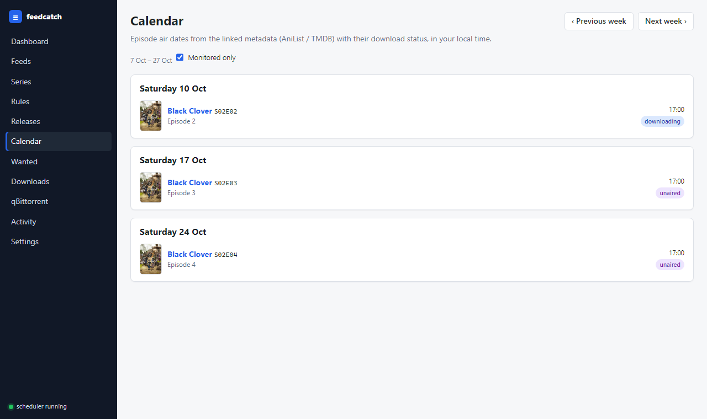

# feedcatch

[](https://github.com/yonatand/feedcatch/actions/workflows/ci.yml)
[](https://github.com/yonatand/feedcatch/actions/workflows/docker.yml)

**RSS -> qBittorrent automation for ongoing series (anime or TV), with the right season folder.**

feedcatch is a small self-hosted service that polls the RSS or Atom feeds you add, matches every new release against the
series, release group, season and quality rules you set in its web UI, and sends the magnet to your **existing
qBittorrent** with an explicit save path such as `/home/qbittorrent-nox/media/Black Clover/Season 02`.
It decides; qBittorrent downloads and seeds. feedcatch never mounts or touches your media folder, never processes a feed
entry twice, and shows you exactly why each release was accepted or rejected.

It also knows which episodes a season has (from AniList or TMDB) and which of them you already have, and it can search
your feeds for episodes that aired before you started following the show.

It replaces Sonarr, autobrr and FlexGet for this one job and depends on none of them.


## How it works

1. Every 15 minutes (configurable) each enabled feed is fetched with a conditional GET and parsed safely.
2. New entries get their title parsed (`[DKB] Black Clover Season 2 - 01 [1080p]` -> group, title, season, episode, resolution, ...).
3. Each enabled rule of a monitored series is evaluated condition by condition. The best match per episode wins; duplicates by episode or infohash are skipped.
4. The save path is built from *media base + series name + season folder*, with per-series and per-season overrides, and the magnet is sent to qBittorrent with that path and `autoTMM=false`.
5. feedcatch reads the torrent back from qBittorrent, verifies the save path, and records everything in Downloads and Activity.

Separately, episode lists are refreshed from the metadata provider, and you can search a feed for older episodes on demand
(see [Episodes and release search](#episodes-and-release-search)).


## What it does and does not do

**Does**
- Polls RSS2 and Atom feeds on a schedule (15 minutes by default), using conditional GET, bounded retries and SSRF guards.
  Entries are remembered across restarts, so none is processed twice.
- Parses release titles (`S02E01`, `Season 2 - 01`, `- 171`, `[DKB] ...`) and evaluates per-series and per-season rules:
  release group, keywords, resolution, source, codec, language, size and an optional Python regex.
- Shows why each release was accepted or rejected, condition by condition.
- Searches **AniList** (anime, no key) or **TMDB** (TV, free API key) when you add a series: pick a result and the name,
  aliases, cover and seasons are prefilled. Metadata never affects matching; matching uses only your rules and aliases.
- Keeps a per-season **episode list** (titles and air dates) with a status for each episode: downloaded, downloading,
  pending, missing, unaired or unknown.
- **Searches feeds for older episodes** through a feed's search URL, on demand and, if you turn it on, on a schedule.
- Shows a **Calendar** of recent and upcoming episodes and a **Wanted** list of aired episodes you don't have.
- Sends torrents with `POST /api/v2/torrents/add` using `savepath=<computed path>`, `autoTMM=false`, an optional category
  and the tag `feedcatch`. It then reads the torrent back from qBittorrent and checks that the save path matches.
- Allows one accepted download per episode by default, with deduplication by episode and by infohash.

**Does not**
- Mount, read, create, move, rename or delete anything in your media folder. The save path is only a string that it
  passes to qBittorrent, and qBittorrent does all file writes. The container has no media volume.
- Pause, resume, move, rename or remove torrents. qBittorrent owns them and keeps seeding.
- Import, rename or post-process completed files.
- Send NZB links to qBittorrent. Entries that only have NZB links are shown with the reason "no torrent/magnet link (NZB-only)".
- Grab historical feed entries automatically, unless you turn on backfill for that feed.
- Grab search results automatically, unless you turn on **Automatic search for missing episodes** in Settings (off by default).
- Speak Torznab or talk to indexer managers. It reads plain RSS/Atom.
- Ship with a feed, series or rule. A fresh install is empty.

## Quick start (Docker Compose)

Requirements: Docker with the Compose v2 plugin, and qBittorrent-nox with its WebUI enabled.

```bash
git clone https://github.com/yonatand/feedcatch.git && cd feedcatch
cp .env.example .env          # optionally edit it (see below)
mkdir -p data                 # app state: SQLite DB + secret.key
docker compose up -d --build
```

Then open `http://<host>:8000`. If you set `APP_PORT` in `.env`, use that port instead.

- Health check: `curl http://<host>:8000/healthz` returns `{"status":"ok","db":"ok","scheduler":"running",...}`.
- The JSON API is under `/api`.
- Logs (JSON on stdout): `docker compose logs -f feedcatch`

### Data directory permissions (Linux hosts)

The container runs as a non-root user, uid:gid `1000:1000` by default, and needs write access to `./data`.
If your host user has a different id, set `PUID` and `PGID` in `.env` to the output of `id -u` and `id -g`.
You can also run `sudo chown -R 1000:1000 ./data`. If the directory isn't writable, the container exits at startup with a
message that explains the fix.

## Run from the published image (no build)

A prebuilt image is published to GitHub Container Registry for **linux/amd64** and **linux/arm64**
(for example a Raspberry Pi 4/5 with a 64-bit OS):

| Tag | Points to |
|---|---|
| `ghcr.io/yonatand/feedcatch:latest` | the latest build of `main` |
| `ghcr.io/yonatand/feedcatch:sha-<short>` | one specific commit, for pinning |
| `ghcr.io/yonatand/feedcatch:X.Y.Z` (and `X.Y`) | a release tagged `vX.Y.Z` |

You don't need to clone the repository. In an empty directory, save this as `docker-compose.yml`:

```yaml
services:
  feedcatch:
    image: ghcr.io/yonatand/feedcatch:latest
    container_name: feedcatch
    restart: unless-stopped
    # Run as the owner of ./data on the host (default 1000:1000).
    user: "${PUID:-1000}:${PGID:-1000}"
    ports:
      - "${APP_PORT:-8000}:8000"
    env_file:
      # Optional so the stack still starts with built-in defaults; normally: cp .env.example .env
      - path: .env
        required: false
    environment:
      # Fixed inside the container; change the published port with APP_PORT in .env.
      APP_DATA_DIR: /data
      APP_HOST: 0.0.0.0
      APP_PORT: "8000"
    extra_hosts:
      # Lets the container reach a qBittorrent-nox running on the Docker host (Linux).
      - "host.docker.internal:host-gateway"
    volumes:
      # App state only: SQLite DB (app.db) and secret.key.
      # The media directory is deliberately NOT mounted. The app never reads or writes media;
      # it only hands save-path strings (e.g. /home/qbittorrent-nox/media/Black Clover/Season 02)
      # to qBittorrent, which owns all file writes.
      - ./data:/data
    healthcheck:
      test: ["CMD", "python", "-c", "import sys,urllib.request; sys.exit(0 if urllib.request.urlopen('http://127.0.0.1:8000/healthz', timeout=4).status == 200 else 1)"]
      interval: 30s
      timeout: 5s
      start_period: 30s
      retries: 3
    # Lets the scheduler finish an in-flight poll/submission on SIGTERM.
    stop_grace_period: 20s
```

Then:

```bash
mkdir -p data                 # app state: SQLite DB + secret.key (see permissions above)
docker compose up -d
```

`.env` is optional. To configure the app, create it next to the compose file with the variables from
[`.env.example`](.env.example) (see [Configuration](#configuration-env)).

If you cloned the repository, the same file is included as `docker-compose.ghcr.yml`:

```bash
cp .env.example .env && mkdir -p data
docker compose -f docker-compose.ghcr.yml up -d
```

To upgrade, pull the new image and recreate the container: `docker compose pull && docker compose up -d`
(add `-f docker-compose.ghcr.yml` if you use that file).

The package is published by GitHub Actions on every push to `main`; if a pull is denied, the package may still be
private in GitHub Packages settings. Packages created by a workflow start out private. The repository owner can make it
public once: on GitHub, open the repository > **Packages** > **feedcatch** > **Package settings** > **Change visibility** >
**Public**.

## First-run setup

1. **Password.** Authentication is on by default. If `APP_PASSWORD` is empty, the first visit sends you to a setup page
   where you choose a password (at least 8 characters). Only its bcrypt hash is stored. If `APP_PASSWORD` is set in `.env`,
   that value is the password and there is no setup page.
2. **Onboarding.** A fresh install has no feeds, series or rules. Until you have at least one feed and one series, the
   Dashboard shows three steps:
   1. **Add a feed** on the Feeds page: pick a preset or paste any RSS/Atom URL (see [Feeds](#feeds)).
   2. **Connect qBittorrent** on the qBittorrent page: enter the details and click **Test Connection** (see below).
   3. **Add a series** with **Series > New**: search AniList or TMDB, or fill in the fields by hand.
3. **Settings.** Check **Media base path**. The default is `/home/qbittorrent-nox/media`. This is the path *as qBittorrent
   sees it*, not a path inside this container. The season folder format defaults to `Season {season:02d}`. For TV shows
   from TMDB, also enter a **TMDB API key** here (see [Metadata providers](#metadata-providers)).

Nothing is downloaded until you have a monitored series with an enabled rule, and even then the poller only grabs releases
that appear in the feed after its first poll (see Backfill under [Feeds](#feeds)).

## Configuration (`.env`)

| Variable | Default | Meaning |
|---|---|---|
| `APP_PORT` | `8000` | Host port to publish. The container always listens on 8000. |
| `PUID` / `PGID` | `1000` | User the container runs as. Must be able to write `./data`. |
| `APP_LOG_LEVEL` | `INFO` | `DEBUG`, `INFO`, `WARNING` or `ERROR`. |
| `APP_SECRET_KEY` | empty | Key that encrypts the stored qBittorrent password and TMDB key and signs session cookies. Empty means a key is generated once into `./data/secret.key`. |
| `APP_PASSWORD` | empty | UI password. When set, it always wins over the password stored in the database. |
| `APP_AUTH_DISABLED` | `false` | `true` removes login completely. Use it only on a trusted network or behind an authenticating proxy. |
| `QBIT_URL` | `http://host.docker.internal:8080` | qBittorrent WebUI URL as seen from the container. |
| `QBIT_USERNAME` / `QBIT_PASSWORD` | empty | qBittorrent WebUI credentials. |
| `FEED_URL` | empty | Optional. If set, one feed with this URL is created on first start, named after its host. Empty means you start with no feed and add feeds in the UI. |
| `TMDB_API_KEY` | empty | TMDB key (v3 API key or v4 read access token) for TV metadata. Empty means you can enter it in Settings, or not use TMDB. |
| `JIKAN_ENABLED` | `true` | Allow the Jikan (MyAnimeList) fallback for episode titles and air dates. `false` disables it entirely. |
| `ALLOW_PRIVATE_FEED_HOSTS` | empty, which means the UI setting is used (default `false`) | Allow feed URLs that resolve to private or loopback addresses. |

`QBIT_URL`, `QBIT_USERNAME`, `QBIT_PASSWORD`, `APP_PASSWORD`, `TMDB_API_KEY` and `ALLOW_PRIVATE_FEED_HOSTS` **override**
values saved in the UI when they are set. The UI marks those fields as coming from `env` and ignores edits to them. To manage
them in the UI instead, leave them empty.

Other settings live only in the UI (Settings page):

| Setting | Default | Meaning |
|---|---|---|
| Media base path | `/home/qbittorrent-nox/media` | Root of the save paths, as qBittorrent sees it. |
| Season folder format | `Season {season:02d}` | Folder name per season. |
| Metadata refresh interval | 12 hours | How often the episode lists of monitored seasons are refreshed from AniList or TMDB. |
| Automatic search for missing episodes | off | When on, periodically searches feeds for missing episodes and grabs the best match. |
| Search interval | 24 hours | How often the automatic search runs (only when it is on). |
| Delay between searches | 3 seconds | Pause between consecutive search requests, to be polite to the site. |

## qBittorrent connection

Tested against qBittorrent v5.2.4 (Web API 2.15.1) and written to the documented v4.x API as well: the client accepts both the `Ok.`/`Fails.` text replies of 4.x and the 204/401/JSON replies of 5.x.

- **URL.** qBittorrent usually runs on the Docker host, so use `http://host.docker.internal:8080`. `docker-compose.yml`
  maps that name to the host gateway with `extra_hosts`. qBittorrent must listen on an interface the container can reach.
  If the WebUI is bound to `127.0.0.1` only, the container can't reach it. Bind it to `0.0.0.0` or to the docker bridge
  address, and restrict access with a firewall if needed.
- **Credentials.** Enter the WebUI username and password. Leave both empty if qBittorrent's "Bypass authentication for
  clients in whitelisted IP subnets" covers the Docker network. The password is stored Fernet-encrypted and is never sent
  back to the browser; the UI only shows whether one is set.
- **Test Connection** logs in and reports:
  - `version` / `api_version`: the qBittorrent version (for example `v5.0.2`) and its Web API version.
  - `default_save_path`: qBittorrent's global default. It doesn't matter here because every torrent gets an explicit path.
  - `auto_tmm_enabled`: when true, you see a warning. Every torrent is sent with `autoTMM=false`, so the explicit save path
    is still used.
  - `category_exists`: whether the optional category exists yet. qBittorrent creates a missing category on the first add.
    A category save path can't override our path, because Automatic Torrent Management (ATM) is off for each torrent.
  - A warning about **temp path** (incomplete files) means qBittorrent downloads into its temp folder first and then moves
    the files to the save path itself. That is normal qBittorrent behavior.
- **Host header and CSRF validation.** The app sends `Origin` and `Referer` headers that match the configured URL. If
  qBittorrent still rejects requests with `403`, **add the hostname you use (for example `host.docker.internal`) to
  qBittorrent > Options > WebUI > "Server domains"**. Don't turn off host-header validation or CSRF protection.
- **Start immediately.** If you turn this off, torrents are added stopped (paused). From then on qBittorrent decides
  everything about downloading and seeding.
- **Category.** Optional, for example `anime` or `tv`. You can also set a category per series.

## Feeds

The Feeds page lets you add, edit, delete and enable feeds and set their polling interval (5 to 1440 minutes).
- **Test URL** fetches a URL live and shows sample entries with their parsed fields.
- **Preview** lists the current entries of a saved feed without storing anything.
- **Poll now** runs one poll immediately.

Any RSS2 or Atom feed whose entries carry magnet links, `.torrent` links or torrent enclosures works: a public tracker's
feed, the RSS feed of a private tracker (usually a URL that contains your passkey), or any other release feed. Feeds aren't
parsed as Torznab, so no indexer manager is needed. When an entry has both a magnet and a torrent link, the magnet is used.
NZB links are recorded but never sent.

The feed form has **presets**. They only fill in the fields; nothing is added until you save:

| Preset | Feed URL | Search URL template |
|---|---|---|
| AnimeTosho (anime) | `https://feed.animetosho.net/rss2` | `https://feed.animetosho.net/rss2?q={query}` |
| Nyaa (anime) | `https://nyaa.si/?page=rss` | `https://nyaa.si/?page=rss&q={query}` |
| Custom RSS/Atom | your URL | optional |

**Search URL template.** Optional. If the site can return search results as RSS, enter that URL here with `{query}` where
the search text goes (exactly once). feedcatch uses it for [release search](#episodes-and-release-search). The template is
checked like a feed URL, with `{query}` replaced by a test word. Feeds without a template are skipped by search.

**Backfill.** With the default `backfill_mode = skip`, a feed's first poll marks every existing entry as **historical**.
Those entries are evaluated and shown in Releases, so you can see what your rules would have matched, but they are
**never grabbed automatically**. Automatic grabbing starts with entries that appear in later polls. You can still grab a
historical entry manually, with a preview and a confirmation step, or find older episodes with release search. Set
`backfill_mode = process` only if you really want the current feed contents grabbed.

Feed URLs are checked against SSRF: only `http` and `https` are allowed, every resolved IP must be public, and every
redirect is checked again (at most 5). To allow a feed on your LAN, turn on **Allow private / LAN feed hosts** in Settings.

## Metadata providers

When you add a series you can search a metadata provider instead of typing everything. Choosing a result prefills the
name, aliases, cover and seasons, and every field stays editable. Each linked season then gets its episode list (titles
and air dates). The list is refreshed every 12 hours by default (Settings > Metadata refresh interval) and on demand with
**Refresh metadata** on the season.

| Provider | For | Key | What it provides |
|---|---|---|---|
| [AniList](https://anilist.co) | anime | none | name, aliases (Latin-script titles and synonyms), cover, episode count, related entries (sequels can be added as the next season), episode air dates, and episode titles where AniList has them |
| [TMDB](https://www.themoviedb.org) | TV | free API key | name, original title as an alias, poster, every season with its episode count, episode titles and air dates |

- **AniList** treats each season as a separate entry, so a second season is its own entry ("Black Clover 2nd Season").
  The wizard and the series page let you link each season to its entry. Episode titles come from AniList's streaming
  links, which are often empty for new seasons; feedcatch then tries Jikan (MyAnimeList) as a best-effort fallback and
  carries on without it when it is slow or down. Set `JIKAN_ENABLED=false` to never call Jikan (some networks block it).
- **TMDB** needs an API key. Create a free account, request a key at <https://www.themoviedb.org/settings/api>, then enter
  it in **Settings > TMDB API key** or set `TMDB_API_KEY` in `.env`. The v3 "API Key" and the v4 "API Read Access Token"
  both work. The key is stored encrypted and never shown again. Without a key, TMDB is disabled in the search box.
- TMDB support was written against the public v3 API documentation and was not exercised live by the author at the time
  of writing. Reports are welcome.
- Covers and posters load from the provider's CDN in your browser.
- Metadata is optional. A series without a link still works for matching and downloading; it just has no episode list.

## Episodes and release search



### Episode list

Each season card on a series page has an **Episodes** table with number, title, air date and status, plus a summary such
as "12 of 24 downloaded · 3 missing". The status is computed from the episode list and your downloads; it is never stored.
Only the newest download for an episode that has not failed counts:

| Status | Meaning |
|---|---|
| downloaded | Sent to qBittorrent, and qBittorrent reports it complete (or seeding). |
| downloading | Sent to qBittorrent and still in progress (the percentage is shown). |
| pending | Waiting to be (re)sent to qBittorrent. |
| missing | Aired (air date in the past) with no active download. An episode with only failed downloads is missing. |
| unaired | Air date in the future, no download yet. |
| unknown | No air date known and no download. |

You can edit an episode's title or air date by hand. A metadata refresh never overwrites a manual edit.

### Search releases (older episodes)

A feed only carries its newest releases, and everything present at the first poll is historical, so episodes that aired
before you added the series are never grabbed by the poller. **Search releases** on a season fills that gap:

1. feedcatch builds queries from the series name and up to two aliases, adding the season (for example ` S02`) unless the
   season uses an absolute episode range. You can also type your own query.
2. It fetches each enabled feed that has a search URL template, at most 6 requests per search with the configured delay
   between them. For AnimeTosho that is for example `https://feed.animetosho.net/rss2?q=black%20clover%20S02`.
3. Every result is checked against the enabled rules of the series that apply to this season. Monitored flags are ignored,
   because you asked explicitly. Only matching releases are listed, grouped by episode, best rule first.
4. You **Grab** one candidate (the same preview and confirm step as a manual grab) or click **Grab all missing**. That shows
   what it will send and, after you confirm, grabs the best candidate for each missing episode. Normal duplicate rules apply.

Search results are stored with the outcome `searched`. They are **never grabbed by the poller**; the poller still only
grabs new arrivals in the regular feed. A search result is only sent when you click Grab, or by automatic search.

**Automatic search** (Settings, off by default): every 24 hours (configurable), feedcatch searches each monitored season
that has missing episodes and grabs the best candidate for each missing episode, at most 20 seasons per run. It relies on
the episode list, so seasons without metadata are skipped. Each run is logged in Activity.

### Calendar and Wanted

- **Calendar** lists episodes by air day, from 7 days ago to 14 days ahead, with previous/next week buttons and a
  "monitored only" toggle (on by default). The Dashboard shows the next 7 days.
- **Wanted** lists every missing episode in monitored seasons, newest first, with **Search** per row and **Search all**
  (up to 10 seasons per click).

## Example: follow Black Clover Season 2 by DKB

This is an example you create yourself; feedcatch doesn't ship with it. It assumes you added a feed with the AnimeTosho
preset. Use **Series > New**. The wizard previews the save path and lets you test the rule against recent releases before
anything is saved.

1. **Search.** Choose **AniList**, type `Black Clover` and click **Use** on the TV entry. The name `Black Clover`, aliases,
   cover and season 1 (170 episodes) are prefilled. Remove or unmonitor season 1 if you only want the new season.
2. **Season 2.** Under "Related on AniList", click **Add as season** on **Black Clover 2nd Season**. It becomes season 2,
   linked to that AniList entry. The computed save path appears right away:
   `/home/qbittorrent-nox/media/Black Clover/Season 02` (media base + series name + `Season {season:02d}`). You can
   override the path for the whole series or for one season. An override must be an absolute POSIX path.

   Without the search: enter the name `Black Clover`, the aliases `Black.Clover` and `Black_Clover`, and season `2`. You can
   link the season to AniList later on the series page. The name is the folder name, after removing `/`, `\`, `..`,
   control characters and similar. Feed titles never become path components.
3. **Rule.** Release group `DKB`, with "require `[DKB]` title prefix" on, resolution `1080p`, and the rule bound to
   season 2. Use **Simulate** to paste sample titles, or **Test recent** (on the series page) to run the rule against stored
   feed entries without side effects.
4. **Absolute numbering.** A title like `[DKB] Black Clover - S02E01 [1080p]` or `... Season 2 - 01` carries an explicit
   season and maps directly. A title without a season, such as `[DKB] Black Clover - 171`, is **rejected as ambiguous**
   unless a season has an **Absolute episode range** covering that number. The app never guesses a season from an absolute number.
   If the releases you want use absolute numbers, set the **Absolute episode range** min on season 2 to the absolute number of season 2
   episode 1 (for example `171`), and set the max if you know it. Then `171` becomes `S02E01` and `172` becomes
   `S02E02`. Check the feed preview to see which numbering the group actually uses.
5. **Episodes.** After you save, season 2's Episodes list is filled from AniList. Episodes that aired before you added the
   series (E01 and E02 at the time of writing) show as **missing**.
6. **Search releases.** Click **Search releases** on season 2, review the candidates per episode and **Grab** them, or use
   **Grab all missing**. Only releases that pass your rule are listed. When this was written, the search `Black Clover S02`
   returned `[DKB] Black Clover - S02E01` and `S02E02` (plus other groups such as FrixySubs and Anime Time), and
   **Grab all missing** sent both to qBittorrent with the save path above. If a group hasn't released an episode, or the
   feed's search doesn't return it, that episode simply has no candidate; add a rule for another group if you don't mind which.
7. **Monitor.** Turn **Monitored** on for the series. From the next poll, a new matching release is sent to qBittorrent
   with `savepath=/home/qbittorrent-nox/media/Black Clover/Season 02`, and the episode moves to downloading, then downloaded.

A release from another group, another series or another season, or a seasonless title without a mapping, is rejected,
and the Match Inspector shows the reason.


## Seeing matching decisions

- **Releases** lists every stored feed entry with its outcome: `accepted`, `rejected`, `no_match`, `historical`,
  `duplicate` or `searched`, plus a summary. You can filter by feed, outcome or text.
- **Match Inspector** (open a release) shows the parsed fields (group, season, episode, resolution, ...) and, for every rule,
  a table of checks with pass/fail and a detail. Examples: `group: DKB`,
  `season: absolute 171 -> season 2 episode 1`, `season: ambiguous: no absolute range mapping for episode 171`.
  **Re-evaluate** runs the rules again without sending anything.
- **Downloads** shows the submission status: `pending` (waiting for a retry), `submitted`, `exists` (already in
  qBittorrent, not added again), `path_mismatch` (qBittorrent reports a different save path) or `failed`. It also shows
  the qBittorrent state and progress, and offers retry, retry all failed, and refresh status.
- **Activity** is the event log: polls, accepts, duplicates, submissions, metadata refreshes, searches and errors.

### Manual grab

Open a release and click **Grab**. The first step is a **preview** that shows the exact save path, category, magnet or
torrent URL and any duplicate or warnings. Nothing is sent until you confirm. If the release has no explicit season, you
choose the season and episode. To grab an episode that already has a download, use the explicit **force** option.

### Duplicate policy

The default `one_per_episode` allows at most one active download per (season, episode) and per infohash. Before every add,
the app checks qBittorrent by infohash. If a response was uncertain, for example a timeout after the add request was sent,
the next attempt checks qBittorrent first instead of adding the torrent again. Transient failures are retried with backoff
up to 8 times. `allow_upgrades` is minimal in this version: it only lets a manual grab replace a `failed` download.
Automatic upgrades are not implemented.

## Verification checklist

Do this once after setup, with the Black Clover example or your own series. Steps 1 to 6 are a **dry run**: nothing is
added to qBittorrent.

1. **qBittorrent:** Test Connection returns `ok`, a version and an API version. Read any warnings.
2. **Feed fetch:** On Feeds, add a feed (for example with the AnimeTosho preset) and click **Test URL**. You should see a
   feed title, an entry count and sample entries with magnet or torrent links.
3. **Preview:** Use **Preview** on the feed, or check Releases after the first poll. Existing entries show as `historical`.
4. **Simulate the rule:** On the Black Clover rule, simulate `[DKB] Black Clover Season 2 - 01 [1080p]`. Expected result:
   matched, season 2, episode 1, save path `/home/qbittorrent-nox/media/Black Clover/Season 02`. Then simulate a
   different group (`[SubsPlease] Black Clover - 01 (1080p)`) and a seasonless `[DKB] Black Clover - 171` without an
   absolute range. Both should be rejected with a visible reason.
5. **Episodes and search:** Season 2's Episodes list shows episodes with air dates (if it is empty, check that the season
   is linked and click **Refresh metadata**). Click **Search releases**: the result shows the queries used, the feeds
   searched and any candidates. Searching sends nothing to qBittorrent.
6. **Grab preview:** Open a release in Releases or a search candidate, click **Grab** and stop at the preview.
   Check that the save path is exactly what you expect.
7. **Live test (only if you explicitly decide to add a real torrent):** Confirm the grab. In qBittorrent (WebUI or
   VueTorrent), find the torrent (tag `feedcatch`) and check that its save path is
   `/home/qbittorrent-nox/media/Black Clover/Season 02`. In Downloads, the status should be `submitted`, not `path_mismatch`,
   and the episode shows as downloading. You can remove the test torrent yourself in qBittorrent; this app never removes torrents.
8. **Go live:** Turn **Monitored** on for the series. New matching releases are now sent automatically. Watch Dashboard
   and Activity after the next poll.

## Troubleshooting

| Symptom | Likely cause and fix |
|---|---|
| qBittorrent test: `403` | Host-header or CSRF validation, or an IP ban after failed logins. Add `host.docker.internal` (or the host name in your URL) to qBittorrent's **Server domains** and check the credentials. A ban clears after qBittorrent's ban timeout or a restart. |
| qBittorrent test: `401` ("login failed") | qBittorrent 5.x answers 401 for wrong credentials **and** for a rejected `Host` header (for example when the port in the URL differs from the WebUI port). Check the credentials first, then add the host name you use to **Server domains**. |
| qBittorrent test: connection refused or timeout | The container can't reach qBittorrent. Check that the WebUI listens on a non-loopback interface, that the port is right, and that the firewall allows the docker bridge. Test with `docker compose exec feedcatch python -c "import urllib.request;print(urllib.request.urlopen('http://host.docker.internal:8080/api/v2/app/version').status)"`. A `403` here still proves the host is reachable. |
| qBittorrent login `Fails.` | Wrong username or password. If they are set in `.env`, they override the UI. Edit `.env` and run `docker compose up -d`. |
| Feed rejected: private or non-public address | The SSRF guard. Turn on **Allow private / LAN feed hosts** in Settings (or `ALLOW_PRIVATE_FEED_HOSTS=true`) only for feeds you trust. |
| Feed status `error`, malformed XML (feedparser "bozo") | The feed returned HTML (an error page or Cloudflare) or invalid XML. Use **Test URL** to see the error, and open the URL in a browser. The site may be down for a while; polling retries with backoff. |
| Release `rejected`: "ambiguous: no absolute range mapping" | The title has no season (for example `- 171`). Set an absolute range on the right season, or grab it manually and choose the season. |
| Download `path_mismatch` | qBittorrent reports a different save path. The torrent was still added. Check that qBittorrent isn't forcing a path (category, temp path still in progress, scripts), and compare the paths in the download's error detail. |
| Download stays `pending` | qBittorrent was unreachable or returned 5xx. Downloads are retried with backoff, or you can use **Retry**. Look in Activity for the error. |
| Nothing is grabbed | The series or season is unmonitored, the rule is disabled, the entries are `historical` or `searched`, or there's a duplicate. The Match Inspector shows which. For episodes that aired earlier, use **Search releases**. |
| TMDB search disabled ("needs a TMDB API key") | No TMDB key is configured. Enter one in **Settings > TMDB API key**, or set `TMDB_API_KEY` in `.env` and run `docker compose up -d`. If searches fail after that, check that you copied the whole key or token. |
| Search releases: no feed has a search URL template | Add a search URL template with `{query}` to at least one enabled feed. The AnimeTosho and Nyaa presets include one. |
| Search releases finds nothing | Look at the queries shown in the result. The site may name the show differently: add that name as an alias, or type your own query (for example without ` S02`, or with the absolute episode number). Results are filtered by your rules, so if your release group isn't among the search results, nothing matches. A search feed also returns only its newest hits (about 75 on AnimeTosho). |
| Episodes list empty | The season isn't linked to a metadata entry. On the series page, link the season (its AniList entry, or the TMDB show) and click **Refresh metadata**. You can also add episodes by hand. |
| Forgot the UI password | Set `APP_PASSWORD=<new>` in `.env` and run `docker compose up -d`. While it is set, it is the password. |
| Container exits: `/data is not writable` | See [Data directory permissions](#data-directory-permissions-linux-hosts). |

## Security notes

- Authentication is **on by default**. The session cookie is HttpOnly and SameSite=Lax, and it is `Secure` when the request
  uses https. Login attempts are rate-limited.
- Don't expose the UI directly to the internet. Keep it on a trusted LAN or VPN, or put it behind a reverse proxy with TLS.
- Behind a TLS-terminating reverse proxy, set `FORWARDED_ALLOW_IPS` in `.env` to the proxy's IP so the session cookie is marked `Secure` (uvicorn reads `X-Forwarded-Proto` only from trusted proxies). Use `*` only if port 8000 is unreachable except through the proxy.
  Use `APP_AUTH_DISABLED=true` only when something in front of the app already does authentication.
- Secrets: the qBittorrent password and the TMDB API key are encrypted with a key from `APP_SECRET_KEY` or from
  `./data/secret.key`, and the UI password is stored as a bcrypt hash. None of them appears in API responses or logs. Logs
  redact keys that look like passwords, secrets, tokens or cookies. `.env` contains secrets, so keep it out of version
  control (it is gitignored).
- A private tracker's feed URL usually contains your passkey. Treat it like a password.
- The container runs as non-root, mounts only `./data`, and needs no access to media.

## Running tests locally

Backend (Python 3.12+ and [uv](https://docs.astral.sh/uv/)):

```bash
cd backend
uv sync --all-extras
uv run ruff check .
uv run ruff format --check .
uv run mypy app
uv run pytest -q
```

Frontend ([Bun](https://bun.sh) 1.x):

```bash
cd frontend
bun install --frozen-lockfile
bun run typecheck
bun run build        # writes the SPA into backend/app/static
```

Docker:

```bash
docker build -t feedcatch:local .
docker compose config
docker compose up -d && curl -s localhost:8000/healthz
```

For local development without Docker, run `scripts/dev.sh`. It starts the backend on :8000 with auth disabled and data in
`backend/.data`, and Vite on :5173, which proxies `/api` to the backend.

## Data and backup

All state is in `./data`:
- `app.db`: SQLite database (WAL mode), holding configuration, feed entries, decisions, episodes and downloads.
- `secret.key`: the encryption key, unless you use `APP_SECRET_KEY`.

To make a backup, stop the container and copy the directory:

```bash
docker compose stop && tar czf feedcatch-backup-$(date +%F).tgz data && docker compose start
```

Without `secret.key` (or the same `APP_SECRET_KEY`), the stored qBittorrent password and TMDB key can't be decrypted. You
would then have to enter them again.

## Upgrading

If you build from source:

```bash
git pull
docker compose up -d --build
```

If you run the published image (pin a `sha-*` or `X.Y.Z` tag instead of `latest` to control when you upgrade):

```bash
docker compose pull           # add -f docker-compose.ghcr.yml if you use that file
docker compose up -d
```

Database migrations run automatically at startup. Back up `./data` before upgrading. An upgrade keeps your existing feeds,
series and rules. A feed whose URL is exactly `https://feed.animetosho.net/rss2` gets the AnimeTosho search URL template
filled in automatically if it has none.

## Project layout

- `backend/` FastAPI + SQLAlchemy + SQLite + APScheduler (Python 3.12+, managed with uv). Tests with pytest and respx.
- `frontend/` React + Vite + TypeScript single-page app, built into `backend/app/static` and served by the backend.
- `Dockerfile`, `docker-compose.yml`, `.env.example` for the one-container deployment.
- `docs/requirements.md` the original specification this project was built from.

## Status

Working MVP. Verified end to end against the live AnimeTosho feed and qBittorrent v5.2.4: rule match, deduplication,
manual and automatic grabs, and the exact save path showing up in qBittorrent. Episode metadata and release search were
verified against the live AniList API and AnimeTosho's search feed. TMDB support has not been tested against the live API.
Automatic quality upgrades and Postgres are not implemented. Issues and pull requests are welcome.

## License

MIT, see [LICENSE](LICENSE).
